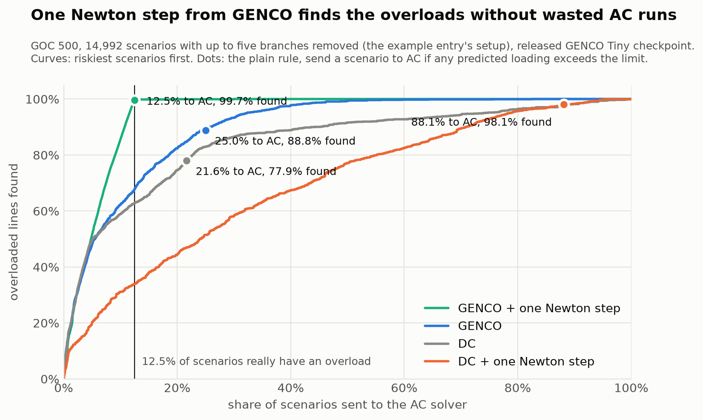

# A Newton step or two is enough

An entry for the [GENCO Challenge](https://gridfm.org/porto/challenge/): GENCO as the first stage of a contingency screen with a stated miss rate. The write-up is in [`submission/POST.md`](submission/POST.md); the poster outline in [`submission/POSTER.md`](submission/POSTER.md).

On GOC 500 with up to five branches removed, one Newton step started from GENCO's prediction sends 12.5% of scenarios to the AC solver (the share that really has an overload) and finds 99.7% of the overloaded lines. The same holds on 2,000 buses; on 10,000 buses it takes two steps. Where no Newton step is taken, a conformal band decides which states go to AC and keeps the share of missed overloads at a chosen level.



## What is here

| Path | What it does |
|---|---|
| `engine.py` | One grid state (load level, line outages, optional redispatch) solved by AC power flow, DC power flow and GENCO. Used by everything else. |
| `analysis_hybrid.py`, `work/texas/04_hybrid.py` | Outage sweeps on IEEE 118 and Texas 2000: per-line loadings from AC, DC and GENCO. |
| `analysis_conformal.py` | The conformal trust layer: band calibration, held-out scoring, coverage over 100 splits, fixed-budget curves. |
| `analysis_goc500.py`, `analysis_goc500_newton.py`, `work/goc500/` | The example entry's setup (GOC 500, N-1 to N-5): its F-beta rule, the conformal band, GENCO + one Newton step. |
| `work/goc2000/`, `work/goc10000/` | The same experiment on 2,000 and 10,000 buses (`run_all.sh` chains generation, Newton steps, analysis and timing). |
| `analysis_warmstart.py`, `analysis_onestep.py` | GENCO as a Newton start point; one Newton step as a physics correction. |
| `analysis_shift.py` | The guarantee under distribution shift (N-3, N-4, load, power factor, redispatch) and recalibration. |
| `analysis_voltage.py` | Voltage-limit violations, which DC power flow cannot see. |
| `analysis_embedding.py` | GENCO's embedding space as a detector of states unlike calibration (a negative result). |
| `analysis_remedial.py` | Ranking redispatch actions with GENCO, GENCO + one Newton step and DC sensitivities. |
| `work/verify_round1.py` | Independent re-derivation of the numbers quoted in the write-up. |
| `analysis_atlas.py` | Where GENCO's errors are: by line, outage, load level, loading. |
| `analysis_residual.py`, `analysis_redispatch.py` | Earlier studies of GENCO's power-balance residual and of off-OPF dispatch. |
| `make_figures.py` | Every figure in `figures/`, drawn from saved results. |
| `server.py`, `web/` | Operator workbench showing the three-stage workflow: `python server.py`, then open http://127.0.0.1:8000 (for example `?load=1.1&out=31,103&alpha=0.01&view=newton`). |
| `run_pretrained.py` | Fetch a released checkpoint and run it on one data shard. |
| `work/**/*.log`, `work/*.txt`, `work/**/*.csv` | The printed reports and small result tables behind the numbers in the write-up. |

## Reproduce

```sh
./reproduce.sh setup      # Python 3.12 environment from requirements.lock.txt (needs uv)
./reproduce.sh fetch      # checkpoints from Hugging Face
./reproduce.sh sweeps     # AC, DC and GENCO on all grid states: several hours on a laptop
./reproduce.sh analysis   # all tables, from the saved sweeps: minutes
./reproduce.sh figures    # figures/*.png
```

The `setup`, `analysis` and `figures` stages were verified in a fresh copy of the repository (with the saved result tables in place); `fetch` and `sweeps` were run piece by piece while the work was done, not through this script.

No model is trained. All checkpoints are the released ones: `gridfm/genco-pf-datakit` (IEEE 118 Base and GOC 500 Tiny, seeds 0, 1 and 42; GOC 2000 and GOC 10000 Tiny and Small) and `gridfm/genco-pf-contingency` (Texas 2000).

## Data

- IEEE 118 and the GOC 500, 2000 and 10000 cases come from PGLib-OPF through gridfm-datakit.
- Texas 2000: place `Texas2k_case1_2016summerpeak.m` in `work/texas/` yourself; it is not redistributed here.
- The large result tables (`*.parquet`) are not in the repository. `./reproduce.sh sweeps` rebuilds them.

## Limits

No speed claim is made: up to 2,000 buses GENCO inference on a laptop is slower than an AC solve, and the 10,000-bus timings compare different implementations. The savings reported are AC solves and Newton iterations. See "Limits of this work" in the write-up.

## Licence

MIT, see `LICENSE`. GENCO, gridfm-graphkit and gridfm-datakit are Apache-2.0 projects of GridFM.
